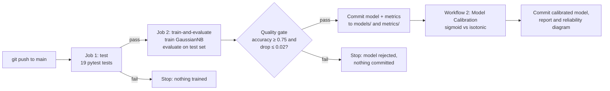
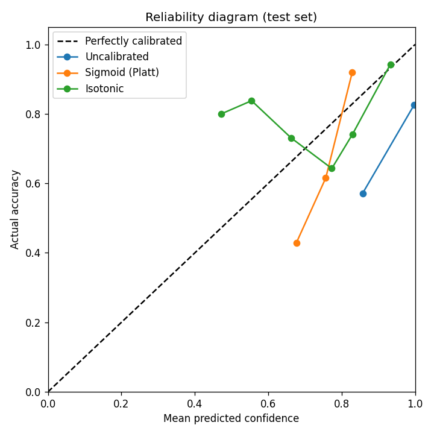
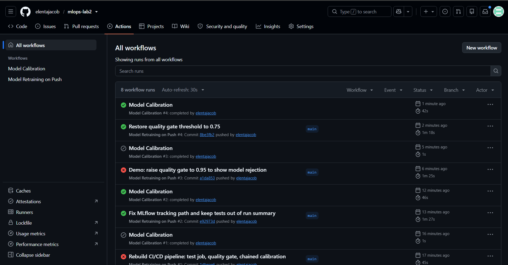
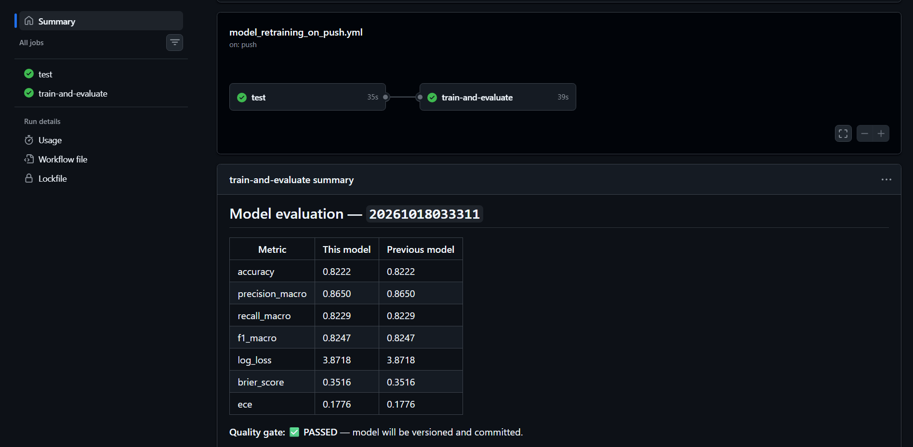
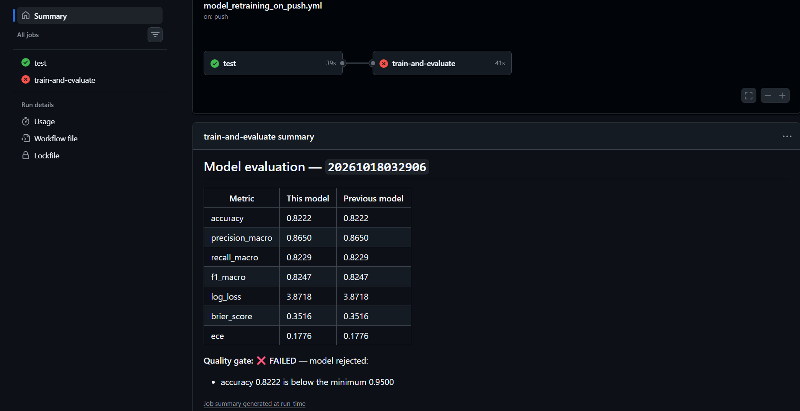
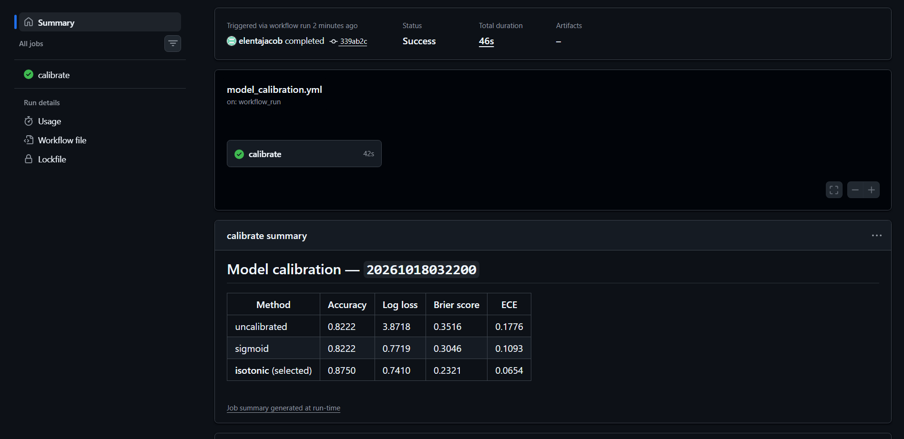
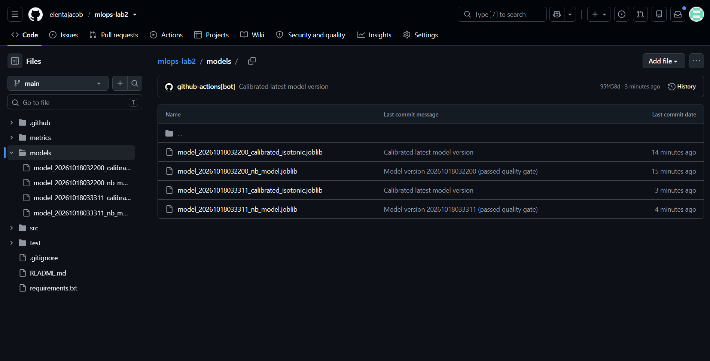
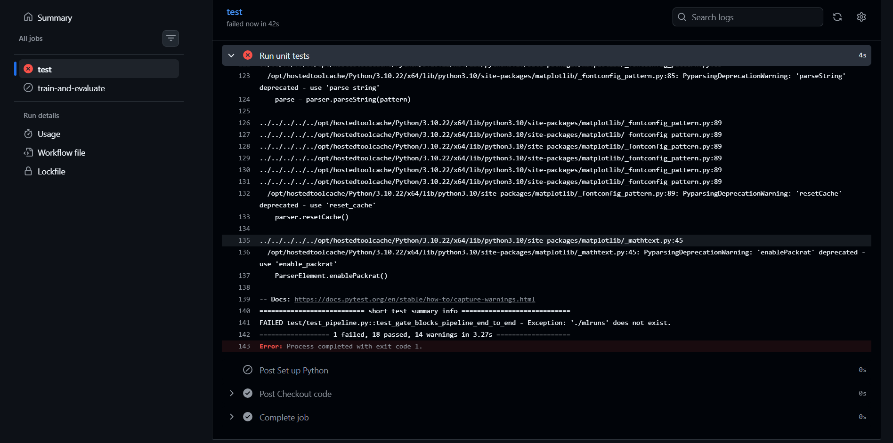

# MLOps Lab 2 — GitHub Actions for Model Training, Versioning & Calibration

**Author:** Elenta Jacob · M.S. Data Science, Northeastern University (Khoury College)

Every push of code to `main` automatically **tests** the code, **trains** a model, checks it against a **quality gate**, **versions** it in the repository, and then **calibrates** it in a second, chained workflow. Rejected models never get versioned.

Based on GitHub Lab 2 from the course repository, with the CI/CD pipeline rebuilt and the ML code replaced. All changes are listed below.

---

## Table of Contents

1. [What I Changed — CI/CD Pipeline](#1-what-i-changed--cicd-pipeline)
2. [What I Changed — ML Code](#2-what-i-changed--ml-code)
3. [How the Pipeline Works](#3-how-the-pipeline-works)
4. [Results](#4-results)
5. [Run It on GitHub (no installation needed)](#5-run-it-on-github-no-installation-needed)
6. [Run It on Your Own Computer](#6-run-it-on-your-own-computer)
7. [What a Successful Run Looks Like](#7-what-a-successful-run-looks-like)
8. [Design Decisions](#8-design-decisions)
9. [Troubleshooting](#9-troubleshooting)
10. [Screenshots](#10-screenshots)

---

## 1. What I Changed — CI/CD Pipeline

This is the core of the lab. The original workflows were rebuilt:

| | Original Lab | My Version |
|---|---|---|
| **Workflow location** | `workflows/` folder in the lab directory, which GitHub ignores; paths hard-coded to the course monorepo | `.github/workflows/`, which GitHub actually runs, with paths for a standalone repo |
| **Testing** | None for Lab 2 (the course's unittest workflow only tested Lab 1) | Dedicated **`test` job** runs 19 pytest tests; **training only starts if all tests pass** (`needs: test`) |
| **Quality gate** | None: every model was committed, however bad | Model is **rejected** (run fails, nothing committed) if test accuracy is below `MIN_ACCURACY` (0.75) or drops more than `MAX_ACCURACY_DROP` (0.02) vs. the previous version |
| **Calibration workflow** | Misnamed: actually a nightly cron *retrain* with no calibration step | **Real calibration**, triggered automatically via `workflow_run` right after a successful retrain; skipped when retraining fails or the gate rejects |
| **Triggers** | Every push to `main` | Only pushes that change `src/`, `test/`, `requirements.txt` or workflows (**path filters**), so README/doc pushes don't retrain; plus a manual **Run workflow** button |
| **Run visibility** | Plain logs only | **Job summaries**: metric tables and gate result rendered on each run page |
| **Artifacts** | None | MLflow tracking data and metrics **uploaded as artifacts on every run**, even failed ones |
| **Safety** | Two runs could push at once | **Concurrency group**, so pipeline runs never push to the repo simultaneously |
| **Permissions** | Implicit | Explicit `permissions: contents: write` (least privilege needed to commit versions) |
| **Actions & Python** | `setup-python@v2`/`v4`, Python 3.8/3.9 | `checkout@v4`, `setup-python@v5` with pip caching, Python 3.10 |
| **Dependencies** | Unpinned | All versions **pinned** in `requirements.txt` |

## 2. What I Changed — ML Code

| | Original Lab | My Version |
|---|---|---|
| **Dataset** | Random synthetic data from `make_classification`, with a random sample count each run (could even be 0) | **Digits** (scikit-learn): 1,797 handwritten digit images, 8×8 pixels = 64 features, 10 classes |
| **Data split** | None: trained and scored on the same data | Stratified **60 / 20 / 20** split (train / calibration / test), fixed seed so every script and workflow gets the identical split |
| **Model** | Random Forest | **Gaussian Naive Bayes** |
| **Evaluation** | F1 score on *newly generated* random data | Held-out test set: accuracy, macro precision / recall / F1, **log loss, multiclass Brier score, Expected Calibration Error (ECE)**, confusion matrix |
| **Dataset statistics** | None | Saved every run: class distribution, balance ratio, pixel range, mean intensity, zero-pixel fraction, constant features |
| **Calibration** | Described in the README but never implemented | `calibrate_model.py` compares **sigmoid (Platt)** and **isotonic** calibration, keeps the one with the lowest Brier score, and saves a **reliability diagram** |
| **Experiment tracking** | MLflow | MLflow kept, with parameters, metrics and timestamp tags |
| **Tests** | A scratch notebook | **19 pytest tests**: data, statistics, metric math, training, evaluation, quality gate, calibration, and a full end-to-end pipeline test |

---

## 3. How the Pipeline Works



Each version is identified by a timestamp (`YYYYMMDDHHMMSS`) generated in the workflow. For a version `T`, the pipeline commits:

| File | Created by | Contents |
|---|---|---|
| `models/model_T_nb_model.joblib` | Retraining | Trained Gaussian Naive Bayes model |
| `metrics/T_dataset_stats.json` | Retraining | Dataset statistics and split sizes |
| `metrics/T_metrics.json` | Retraining | Test metrics, confusion matrix, quality gate result |
| `models/model_T_calibrated_<method>.joblib` | Calibration | Calibrated model (best method) |
| `metrics/T_calibration.json` | Calibration | Uncalibrated vs. sigmoid vs. isotonic comparison |
| `metrics/T_reliability.png` | Calibration | Reliability diagram |

### Repository structure

```
mlops-lab2/
├── .github/workflows/
│   ├── model_retraining_on_push.yml   # Workflow 1: test -> train -> evaluate -> gate -> version
│   └── model_calibration.yml          # Workflow 2: calibrate the newest version
├── src/
│   ├── ml_utils.py                    # Data loading, split, statistics, probability metrics
│   ├── train_model.py                 # Trains GaussianNB, saves model + dataset stats, logs to MLflow
│   ├── evaluate_model.py              # Test-set metrics, quality gate, job summary
│   └── calibrate_model.py             # Sigmoid vs isotonic calibration + reliability diagram
├── test/
│   ├── conftest.py                    # Makes src/ importable in tests
│   └── test_pipeline.py               # 19 pytest tests
├── models/                            # Versioned models (committed by the pipeline)
├── metrics/                           # Versioned metrics and reports (committed by the pipeline)
├── screenshots/                       # Evidence of pipeline runs
└── requirements.txt                   # Pinned dependencies
```

---

## 4. Results

**Dataset statistics:** 1,797 samples, 64 features, 10 classes, 0 missing values. Classes are balanced (174–183 per digit, balance ratio 0.95). Pixel values range 0–16, 49% of pixels are zero, and 3 pixel positions are always blank.

**Split:** 1,078 train / 359 calibration / 360 test.

### Test-set performance (uncalibrated model)

| Metric | Score |
|---|---|
| Accuracy | 0.8222 |
| Precision (macro) | 0.8650 |
| Recall (macro) | 0.8229 |
| F1 (macro) | 0.8247 |
| Log loss | 3.8718 |
| Brier score | 0.3516 |
| ECE | 0.1776 |

### Calibration

| Method | Accuracy | Log loss | Brier score | ECE |
|---|---|---|---|---|
| Uncalibrated | 0.8222 | 3.8718 | 0.3516 | 0.1776 |
| Sigmoid (Platt) | 0.8222 | 0.7719 | 0.3046 | 0.1093 |
| **Isotonic (selected)** | **0.8750** | **0.7410** | **0.2321** | **0.0654** |

Isotonic calibration cut log loss by **81%** and calibration error by **63%**, and it also raised accuracy from 82.2% to 87.5%.



The uncalibrated model is **overconfident**: it reports close to 100% confidence while being right only about 80% of the time. The isotonic curve sits much closer to the diagonal, meaning its probabilities can be trusted.

---

## 5. Run It on GitHub (no installation needed)

You only need a free GitHub account and a web browser.

1. **Fork** this repository (Fork button, top-right) or import it into a new repository of your own.
2. Go to **Settings → Actions → General**:
   - Under **Actions permissions**, select **Allow all actions and reusable workflows**.
   - Under **Workflow permissions**, select **Read and write permissions**, then click **Save**. This lets the pipeline commit model versions.
3. Go to the **Actions** tab. On a fork, click **I understand my workflows, go ahead and enable them**.
4. Click **Model Retraining on Push** → **Run workflow** → **Run workflow**.
   (Or push any change to a file in `src/`, `test/`, `requirements.txt` or `.github/workflows/`.)
5. Wait about 2 minutes. When it finishes, **Model Calibration** starts automatically (about 1 more minute).
6. Check the **Code** tab: new files appear in `models/` and `metrics/`.

No secrets or cloud accounts are needed.

---

## 6. Run It on Your Own Computer

### 6.1 Install the prerequisites

| Tool | Version | Where to get it |
|---|---|---|
| **Python** | **3.10** (3.10.x; matches the CI pipeline) | https://www.python.org/downloads/ — on Windows, tick **"Add python.exe to PATH"** during installation |
| **Git** | Any recent version (tested with 2.52) | https://git-scm.com/downloads |

Check both are installed by opening a terminal (Windows: **Command Prompt**; macOS: **Terminal**):

```bash
python --version      # should print Python 3.10.x   (macOS: python3 --version)
git --version
```

### 6.2 Get the code

```bash
git clone https://github.com/elentajacob/mlops-lab2.git
cd mlops-lab2
```

### 6.3 Create a virtual environment and install dependencies

**Windows (Command Prompt):**
```bat
python -m venv venv
venv\Scripts\activate
pip install -r requirements.txt
```

**macOS / Linux:**
```bash
python3 -m venv venv
source venv/bin/activate
pip install -r requirements.txt
```

Your prompt now starts with `(venv)`. Installation takes 1–3 minutes. Pinned versions:

| Package | Version | Used for |
|---|---|---|
| numpy | 1.26.4 | Arrays and statistics |
| scikit-learn | 1.5.2 | Dataset, model, metrics, calibration |
| joblib | 1.4.2 | Saving / loading models |
| matplotlib | 3.9.2 | Reliability diagram |
| mlflow | 2.17.2 | Experiment tracking |
| pytest | 8.3.3 | Unit tests |

### 6.4 Run the tests

```bash
python -m pytest test/ -v
```

### 6.5 Run the pipeline steps

Use any 14-digit timestamp (the workflow generates one automatically):

```bash
python src/train_model.py --timestamp 20260101120000
python src/evaluate_model.py --timestamp 20260101120000
python src/calibrate_model.py
```

Optional: try the quality gate with an impossible bar to see a rejection:

```bash
python src/evaluate_model.py --timestamp 20260101120000 --min-accuracy 0.95
```

Optional: browse the MLflow runs in your browser:

```bash
mlflow ui --backend-store-uri mlruns
```
Then open http://127.0.0.1:5000 (press Ctrl + C in the terminal to stop it).

> Local runs add files to `models/` and `metrics/`. If you don't want to keep them, delete them before committing.

---

## 7. What a Successful Run Looks Like

### On GitHub

- **Model Retraining on Push:** both jobs green (**test → train-and-evaluate**). The run page shows a *Model evaluation* table ending in **"Quality gate: ✅ PASSED"**, and a bot commit *"Model version … (passed quality gate)"* appears in the repo.
- **Model Calibration:** starts by itself, turns green, shows a *Model calibration* table with the selected method, and adds a bot commit *"Calibrated latest model version"*.
- **A rejected model:** `train-and-evaluate` turns red at *"Evaluate model and apply quality gate"*, the table ends in **"Quality gate: ❌ FAILED"** with the reason, nothing is committed, and calibration shows as **skipped**.

### On your computer

`python -m pytest test/ -v` ends with:
```
======================== 19 passed in ...s ========================
```

`evaluate_model.py` ends with:
```
Metrics saved to metrics/20260101120000_metrics.json
Quality gate PASSED
```

`calibrate_model.py` ends with:
```
Best method (lowest Brier score): isotonic
Calibrated model saved to models/model_20260101120000_calibrated_isotonic.joblib
```

Your numbers should match the [Results](#4-results) tables exactly, because the data split is seeded.

---

## 8. Design Decisions

- **Why Gaussian Naive Bayes?** It is the textbook example of a poorly calibrated model, because it assumes pixels are independent, which they are not. That makes the calibration step genuinely useful. Its 82% accuracy is typical for this model on Digits; stronger models reach 97–99% but are already well calibrated, so calibration would change almost nothing.
- **Why chain calibration with `workflow_run` instead of a schedule?** The original nightly schedule retrained even when nothing had changed. The Digits data is static, so a nightly run would produce an identical model and a duplicate commit every day. Chaining guarantees calibration always runs on the model that was just versioned, and never on a rejected one.
- **Why a separate calibration split?** Calibrating on training data would be biased, and calibrating on test data would leak. The 20% calibration split keeps the test set untouched for honest reporting.
- **Why pick the calibration method by Brier score?** Brier score measures both accuracy and calibration of the full probability vector, so it rewards the method whose probabilities are most trustworthy overall.
- **Why the 0.02 drop tolerance?** It blocks real regressions while allowing tiny run-to-run variation if the model or data ever becomes non-deterministic.

## 9. Troubleshooting

| Problem | Fix |
|---|---|
| `python` is not recognized (Windows) | Reinstall Python and tick **"Add python.exe to PATH"**, then reopen Command Prompt |
| `ModuleNotFoundError` when running tests | Activate the virtual environment (`venv\Scripts\activate` or `source venv/bin/activate`) and run from the repository root with `python -m pytest` |
| Workflow fails at the commit step with a 403 error | Settings → Actions → General → **Workflow permissions → Read and write permissions** |
| Model Calibration never starts | It only runs after **Model Retraining on Push** succeeds; check the retraining run first |
| Pushing a README change didn't start the pipeline | Expected: path filters skip retraining for non-code changes. Use **Run workflow** to trigger it manually |
| `git push` is rejected after a pipeline run | The pipeline committed new versions; run `git pull` first, then push |

---

## 10. Screenshots

### Actions history: every pipeline outcome
Tests catching a bug (#1), a passing version (#2), the quality gate rejecting a model (#3), and a passing version compared against the previous one (#4). Calibration ran only after successful retrains.



### Passing run: test → train-and-evaluate, gate passed vs. previous version


### Quality gate rejecting a model (threshold temporarily raised to 0.95)


### Chained calibration: sigmoid vs. isotonic


### Versioned models committed by the pipeline


### Test job blocking training after catching a bug

